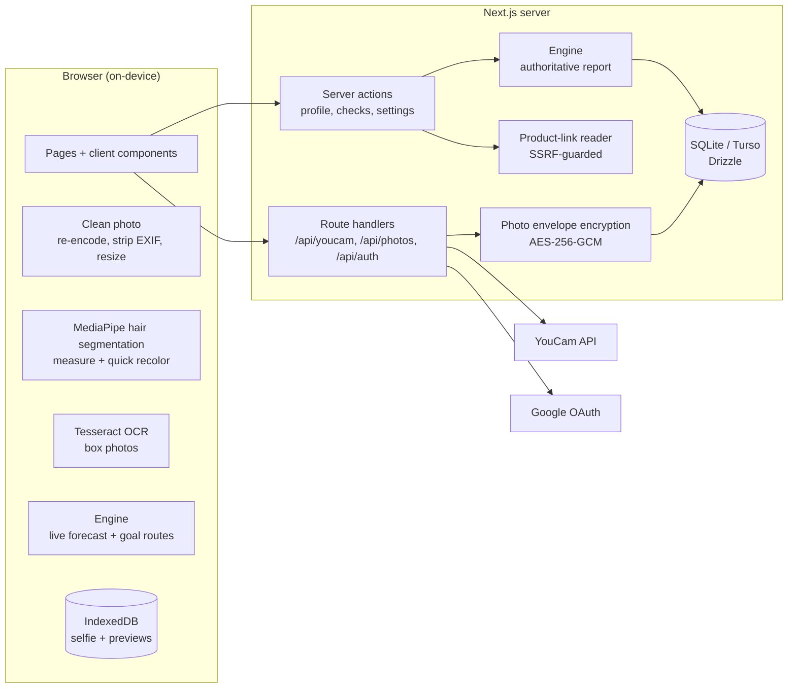

# DyeCast — the reality check for at-home hair color

> **The box has a promise. Your hair has a history.**

DyeCast shows what a box dye will *really* do to **your** hair before it's on your head: the box's promise next to
your likely result — on realistic hair swatches and on your own photo with **YouCam AI Hair Color** — plus the
reasons, the route that actually gets you to your goal, a personal step-by-step plan, and clear safety stop signs.

Built for the **YouCam API Skin AI & eCommerce VTO Hackathon**.

## Why it matters

- Box models start from light, untouched hair. Yours may be darker, warmer, previously dyed, partly gray or porous.
- Box dye lifts only 2–3 levels (high-lift ~4), lightening exposes warm pigment, and **color can't lift color** — so
  "ash blonde" on dark or dyed hair often turns out orange, patchy, or not lighter at all.
- An opened box can't be returned, and fixing a bad result costs far more than the box.
- Try-on apps paint the *box* color onto your photo — the promise, not the outcome. DyeCast forecasts the outcome
  from your starting point first, **then** renders it.

## What you can do

1. **Describe your hair — no photo needed.** Ten levels shown as realistic hair locks in your own tone, plus tone,
   color history (never colored, dyed, highlighted, bleached, henna), gray share, ends condition, texture, strand
   thickness, length and density. Optionally, a selfie *suggests* values (on-device hair measurement + YouCam
   analysis). You confirm every value; the forecast uses your choices, not raw pixels.
2. **Choose what you're aiming for — four ways:**
   - **My goal** — pick one of 16 goal colors, or match the hair in an inspiration photo (measured on your device).
     DyeCast searches box routes (shade, plus a toner when it helps) from *your* hair and shows how close each lands.
   - **Shade code** — `9.1`, `7/43`, `6G`, `5-0`… across international, Wella-style, Schwarzkopf-style and US letter
     numbering. Ambiguous codes are shown both ways.
   - **Box photo** — snap the box; the shade number is read **on your device** (OCR) and offered as candidates.
   - **Product link** — paste a store page; the server reads its title and product data safely and extracts shades.

   A **live forecast** updates while you choose.
3. **Get your reality check:** today vs. box promise vs. likely result (roots and lengths separately, e.g. hot roots;
   highlights and gray drawn as their own strands, because they take dye differently), the color gap (ΔE2000) with a
   certainty label, rule-by-rule reasons, how many boxes your length and density need, better routes, a personal plan
   (decide → before → apply → after) and a safety checklist based on FDA, NHS and EU guidance.
4. **See it on you:** YouCam AI Hair Color renders the box promise *and* your predicted result on your selfie
   (an ombre render for two-zone results), or get a quick preview computed entirely on your device.
5. **Keep a private color notebook:** saved checks, history, data export and one-click account deletion.

No account? Open **`/examples`**: six common situations (dark brown to ash blonde from one box, a lighter box over old
dye, covering lots of gray, bleached blonde back to brown, a same-level refresh, all-over color on highlights) forecast
with the same engine.

## YouCam APIs used

| YouCam API | Feature | How DyeCast uses it | Units |
|---|---|---|---|
| File API | `POST /s2s/v2.0/file` | Upload a cleaned selfie (presigned PUT) | — |
| AI Facial Color Tones | `skin-tone-analysis` | Hair color class and hex → suggested level and tone | 20 |
| AI Hair Length Detection | `hair-length-detection` | Suggested length → box count | 2 |
| AI Hair Density Detection | `hair-density-detection` | Optional hairline photo → density → box count | 1 |
| AI Hair Color (try-on) | `hair-color` | Render the box promise and the predicted result (`full`, or `ombre` for roots vs. lengths) | 1 per render |
| Task API | `POST /s2s/v2.0/task/delete` | Delete each task as soon as its results are delivered, which also deletes its uploaded photo and outputs | — |

A photo analysis costs 22 units (23 with the hairline photo); a YouCam preview costs 2 (promise + result). The
forecast itself comes from DyeCast's own deterministic color-chemistry engine: **YouCam provides the perception (your
hair now) and the realistic render (your hair after)**.

Without an API key, DyeCast runs in **demo mode**: canned YouCam responses, the on-device renderer for previews, and
zero units spent. Every screen still works.

## Architecture



| Path | Responsibility |
|---|---|
| [src/lib/engine](src/lib/engine) | Pure color-chemistry engine, no I/O; runs on the server (authoritative) and in the browser (live forecast) |
| [src/lib/color](src/lib/color) | sRGB ↔ CIELAB conversion and ΔE2000 |
| [src/lib/checks](src/lib/checks) | Domain layer: zod schemas, report building, profile and check persistence |
| [src/lib/auth](src/lib/auth) | scrypt passwords, hashed sessions, DB-backed rate limits, Google OAuth (arctic) |
| [src/lib/photos](src/lib/photos) | Photo validation, envelope encryption, 30-day retention, crypto-shredding |
| [src/lib/youcam](src/lib/youcam) | YouCam client, per-user budgets and ownership checks, task deletion, demo mode |
| [src/lib/product-link](src/lib/product-link) | SSRF-safe page fetching and shade extraction |
| [src/lib/client](src/lib/client) | Browser-only: photo cleaning, IndexedDB, MediaPipe, OCR, API wrappers |
| [src/app](src/app) | Pages, server actions and route handlers |
| [src/components](src/components) | UI: SVG hair swatches, check wizard, results, profile editor |
| [src/data](src/data) | Goal colors and worked examples |
| [drizzle](drizzle) | SQL migrations |

### The engine

Every forecast is explainable. Colors are modeled in CIELAB, and these rules decide the result:

| Rule | What it captures |
|---|---|
| R1 | Semi/demi color can't lighten |
| R2 | Going darker or staying level deposits reliably |
| R3 | Lift limits per product type (and fine/coarse hair) — where the lift stalls |
| R4 | Lightening exposes warm underlying pigment (red → orange → gold → yellow) |
| R5 | A cool tone only partly cancels that warmth |
| R6 | Color can't lift color: dyed lengths won't get lighter |
| R7 | Hot roots on natural roots |
| R8 | Gray coverage and how gray shows the dye's tone |
| R9 | Porous ends grab more color |
| R10 | Going much darker on very light hair looks flat or green without a filler |
| R11 | Fine hair processes fast; coarse hair resists |
| R12 | Highlights take dye differently (stripes) |
| R13 | Henna and plant dyes need a colorist |

On top of the rules: [get-there.ts](src/lib/engine/get-there.ts) searches routes toward a goal color,
[plan.ts](src/lib/engine/plan.ts) builds the step-by-step plan, [safety.ts](src/lib/engine/safety.ts) the safety
checklist (FDA hair-dye checklist, NHS reaction and pregnancy guidance, EU label warnings),
[boxes.ts](src/lib/engine/boxes.ts) the box count, [swatch.ts](src/lib/engine/swatch.ts) turns hair and forecasts into
swatch colors (roots, highlight and gray strands), and [shade-code.ts](src/lib/engine/shade-code.ts) decodes codes and
finds them in noisy OCR or page text (ignoring quantities such as `1.7 fl oz`, even when OCR reads it as `floz`).
Server actions recompute every report from validated input; the browser's forecast is a preview, never trusted.

## Security and privacy

**Photos**
- Photos are optional. A box photo or inspiration photo never leaves the device (OCR and hair measurement run in the
  browser).
- Selfies are re-encoded in the browser before upload, which strips EXIF (GPS, camera) and downsizes them.
- Upload requires explicit consent. The server re-validates type by magic bytes, size and dimensions.
- Each YouCam task gets its own upload, and the task is deleted right after its results are delivered, which also
  deletes that uploaded photo at YouCam. Render URLs never reach the browser: images stream through the server once,
  then the URL is discarded.
- Stored selfies are **off by default**. If enabled: AES-256-GCM with a per-user data key, wrapped by a server key
  that never sits in the database; the ciphertext is bound to the user and photo (AAD), auto-deleted after 30 days,
  served with `no-store`. Deleting destroys the user's key (crypto-shredding).

**Accounts**
- scrypt password hashing (N=2^15, r=8, p=1). Session tokens are random and stored only as SHA-256 hashes, in
  `HttpOnly`, `SameSite=Lax` cookies (`Secure` in production). The login error never reveals whether an account exists.
- Google sign-in uses OAuth 2.0 with PKCE and state, and validates the ID token's issuer, audience, expiry and verified
  email. Linking Google to an existing account whose email was never verified removes the old password and signs out
  its sessions (pre-account-hijacking defence).
- DB-backed rate limits on every write: sign-in, registration, password changes, Google callbacks, profile saves,
  checks, product-link lookups and YouCam calls. Per-user daily YouCam budgets plus a floor on the account's remaining
  units.
- Every query is scoped to the signed-in user; YouCam file and task IDs are checked for ownership.

**Web**
- Content-Security-Policy, `X-Frame-Options: DENY`, `nosniff`, strict Referrer-Policy, Permissions-Policy (camera
  only for this site), COOP, and HSTS in production. API mutations require a same-origin request.
- The product-link reader blocks private and reserved addresses at connect time (DNS-rebinding safe), re-checks every
  redirect (max 3), and caps time (8 s), size (1.5 MB) and content type (HTML only).

**Your data** — export everything as JSON, sign out on every device, or delete the account and all of its data from
Settings. See [the in-app privacy page](src/app/privacy/page.tsx).

## Run locally

Requires **Node.js 22+**. Everything is free: no paid service is needed to run the full app in demo mode.

```powershell
npm ci
Copy-Item .env.example .env.local   # then edit .env.local
npm run db:migrate
npm run dev
```

Open http://localhost:3000, register, describe your hair, and check a shade or goal.

### Configuration (`.env.local`)

| Variable | Purpose |
|---|---|
| `APP_URL` | Public base URL, used for the Google redirect URI |
| `YOUCAM_API_KEY` | YouCam API key (leave empty for demo mode) |
| `YOUCAM_MOCK` | `1` forces demo mode even with a key |
| `YOUCAM_DAILY_UNITS_PER_USER`, `YOUCAM_DAILY_UNITS_TOTAL`, `YOUCAM_MIN_REMAINING_UNITS` | Budget guards: per user per day, all users per day, and a reserve that is never spent (defaults 80, 300 and 60) |
| `GOOGLE_CLIENT_ID`, `GOOGLE_CLIENT_SECRET` | Google sign-in; the button appears only when both are set |
| `PHOTO_ENCRYPTION_KEY` | 32-byte base64 key that wraps per-user photo keys; empty disables photo storage |
| `TURSO_DATABASE_URL`, `TURSO_AUTH_TOKEN` | Database (local SQLite file by default) |

Generate a photo key with:

```powershell
node -e "console.log(require('crypto').randomBytes(32).toString('base64'))"
```

Never commit `.env.local` or the `data/*.db` files (both are git-ignored).

### Google sign-in

1. In Google Cloud Console, configure the OAuth consent screen (scopes `openid`, `email`, `profile`).
2. Create an OAuth client ID of type **Web application** with the authorized redirect URI
   `<APP_URL>/api/auth/google/callback` (for example `http://localhost:3000/api/auth/google/callback`).
3. Put the client ID and secret in `.env.local` and restart the server.

### YouCam

Create an API key in the YouCam API console, set `YOUCAM_API_KEY`, and set `YOUCAM_MOCK=0`. Keep the budget variables
low for a public demo.

## Scripts

| Command | What it does |
|---|---|
| `npm run dev` | Development server |
| `npm run build` / `npm start` | Production build and server |
| `npm test` | Vitest suite (182 tests) |
| `npm run typecheck` | TypeScript, no emit |
| `npm run lint` | ESLint |
| `npm run db:generate` / `npm run db:migrate` | Create / apply Drizzle migrations |

The tests cover the engine (every rule, shade decoding, candidates in noisy text, routes, plans, safety), the worked
examples (each one must show what its lesson says), color math, photo validation and encryption, SSRF guards and page
extraction, Google claim validation, and integration tests that run the real migrations on in-memory libSQL: email and
Google accounts, account linking, profiles, checks from all four sources, per-user isolation, encrypted photo storage
with crypto-shredding, and account deletion.

## Deploy for free

- **App:** Vercel Hobby (or any Node host). Set the variables above and `APP_URL` to the deployed URL.
- **Database:** Turso free tier. Set `TURSO_DATABASE_URL` (`libsql://…`) and `TURSO_AUTH_TOKEN`, then run
  `npm run db:migrate` with those variables. Rate limits and budgets live in the database, so they work across
  serverless instances.
- Add the deployed callback URL to the Google OAuth client.

## Honest limitations

- DyeCast is a rule-based forecast from general hair-color chemistry, not a per-brand formula model, and it makes no
  measured accuracy claim yet. Shades are generic references by level and tone; brands vary.
- Photos read hair darker or lighter depending on light, which is why photo values are only suggestions. YouCam's hair
  color class can also misread warm light (it called very dark brown hair "Auburn" in testing), so a red class only
  counts when the on-device measurement agrees.
- Photo try-ons keep very dark hair's natural depth: on near-black hair even YouCam's "Platinum Blonde" preset renders
  as a dark olive. Much lighter boxes therefore look darker in the photo than on the box; the swatches show true colors.
- Email/password accounts don't have email verification or password reset yet; Google sign-in covers verified
  identity, and a Google sign-in can recover an account with the same email.
- It is not medical advice. The product's instructions, the allergy alert test and a strand test always come first;
  henna history, big lifts and damaged hair are routed to a professional.

## License

[MIT](LICENSE)
